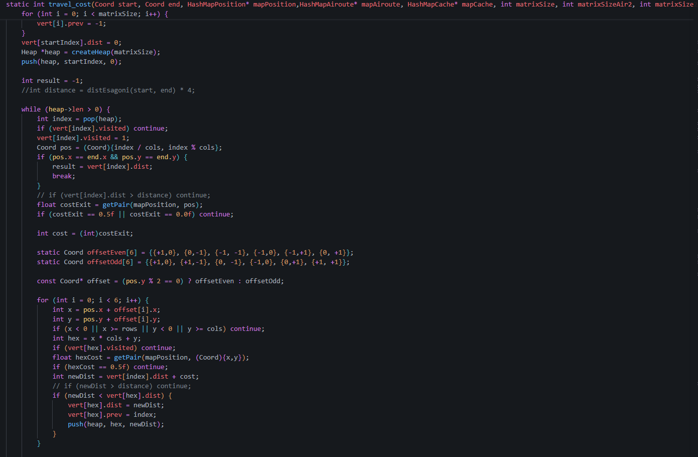

# Movhex — Prova finale di Algoritmi e Principi dell'Informatica

Politecnico di Milano · Algoritmi e Principi dell'Informatica · **Voto: 30/30**

Programma in C che gestisce una **mappa esagonale** in cui ogni cella ha un costo di attraversamento, con in più delle **rotte aeree** tra celle, e risponde a richieste di **percorso a costo minimo**. Legge i comandi da standard input e scrive i risultati su standard output.



## Comandi

| Comando | Argomenti | Output |
|---|---|---|
| `init` | dimensioni della griglia | `OK` (azzera anche l'eventuale mappa precedente) |
| `change_cost` | `x y v ray` | `OK` / `KO` |
| `toggle_air_route` | `x1 y1 x2 y2` | `OK` / `KO` |
| `travel_cost` | `x1 y1 x2 y2` | costo minimo, oppure `-1` se il percorso non esiste o le coordinate non sono valide |

- `change_cost` modifica il costo di una cella e delle celle entro `ray` passi esagonali da essa.
- `toggle_air_route` aggiunge la rotta tra le due celle, oppure la rimuove se esiste già.
- Prima di `init`, i comandi che modificano la mappa rispondono `KO` e `travel_cost` risponde `-1`.

## Come funziona

- **Geometria esagonale**: le coordinate offset vengono convertite in coordinate cubiche per calcolare la distanza tra esagoni (usata per il raggio di `change_cost`).
- **Hash map scritte da zero**, con liste di collisione e dimensione della tabella potenza di due, senza librerie esterne. Ce ne sono tre: una per i costi delle celle, una per le liste di adiacenza delle rotte aeree, una per la cache delle query. I costi delle rotte restano aggiornati quando cambiano i costi delle celle.
- **Dijkstra** con **min-heap binario** scritto a mano e **terminazione anticipata** appena viene estratto il nodo di arrivo.
- **Cache dei risultati** di `travel_cost`, con chiave (partenza, arrivo), invalidata a ogni modifica della mappa.
- Gestione manuale della memoria, con rilascio esplicito di tutte le strutture.

## Compilazione ed esecuzione

```bash
gcc -O2 -o movhex main.c
./movhex < input.txt
```

oppure con CMake:

```bash
cmake -S . -B build && cmake --build build
./build/progettoAPIPaoloBrusa < input.txt
```

Esempio di sessione:

```
init 5 5
OK
change_cost 2 2 10 1
OK
travel_cost 0 0 4 4
<costo minimo>
```

## File

- `main.c`: l'intera implementazione (circa 640 righe)
- `CMakeLists.txt`: configurazione della build